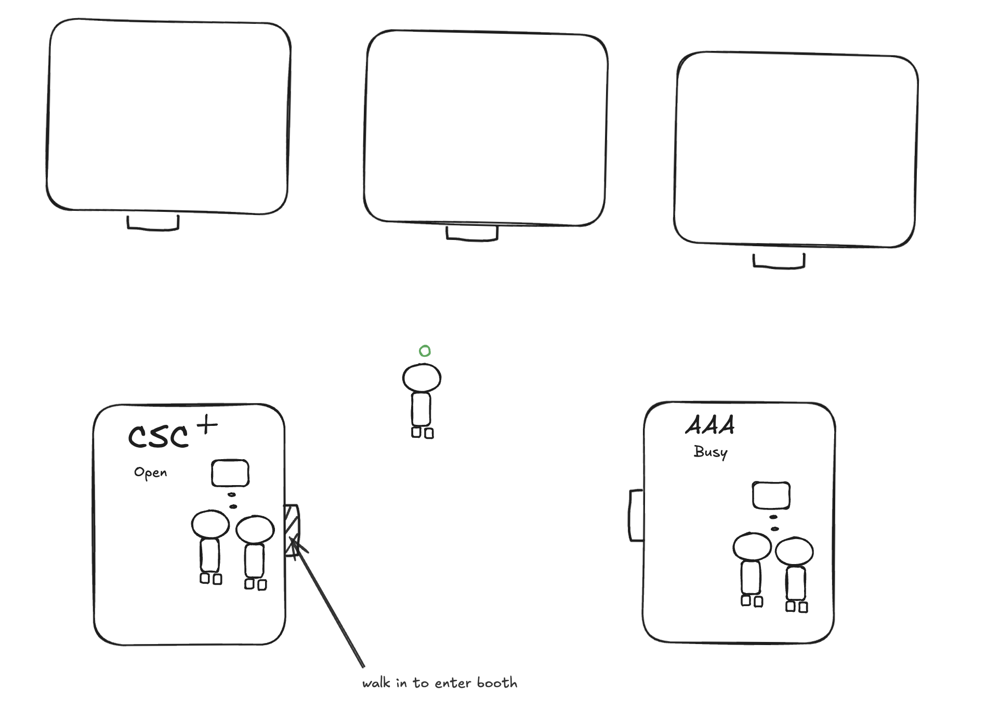
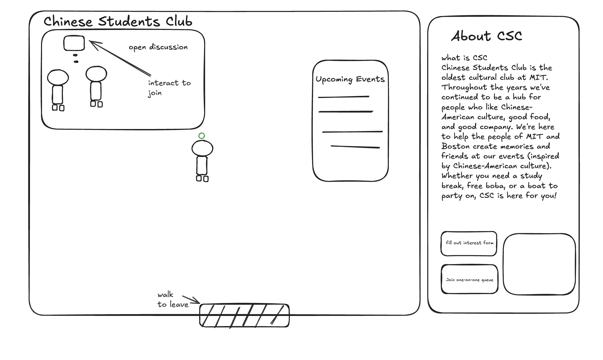
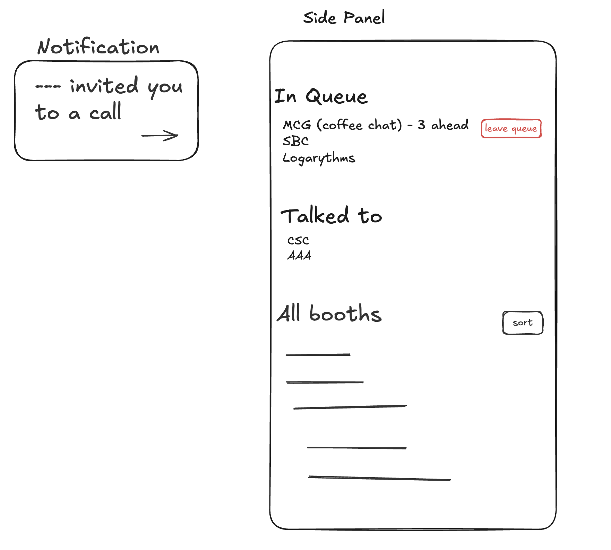

# Problem Framing and Stakeholders

## Domain

At a campus fair, students explore organizations they may want to join or employers they may want to work for. They usually arrive with incomplete information: a student may know a few names, but a short conversation can reveal what a club actually does, what a role involves, or whether an organization is a good fit. Representatives answer questions, introduce their organizations, and hope to meet students who might not have sought them out otherwise. Organizers bring these groups together for a limited time and try to make it possible for attendees to discover them.

In an online fair, the organizer must give attendees a way to find organizations and reach their representatives. A small fair might distribute a directory of descriptions and video-call links. A larger fair might use scheduled one-to-one sessions, group sessions, or virtual booths. The focus here is the _exploratory, live part_ of such events: a student moves among organizations, decides whom to approach, has a brief conversation, and then continues exploring. It applies to both club and career fairs, though a career conversation can have higher stakes and may require more privacy.

## Bad situations

A student joins an online club fair with an hour to explore. They recognize two organizations in the directory and open one of their calls. The representatives are already talking with other attendees, so the student cannot tell whether to interrupt or wait. They leave and open another link, which leads to an empty room. After several such attempts, they return to the familiar organizations and leave the event. A club they might have liked was present, but the student never found a comfortable moment to ask what it does. The club's representatives also miss a potential member. The harm is the loss of a useful encounter during a short event.

A career fair can produce a related situation. A student learns of an employer during the event and wants to ask whether a role fits their interests. The relevant one-to-one sessions were booked earlier, while a group presentation does not give the student a clear chance to ask a personal question. The student may leave with only the information already available on the employer's website, and the employer never learns of the student's interest. This scenario does not imply that all career-fair platforms work this way; it identifies the kind of missed encounter the project would need to prevent.

Visitors cannot be spontaneous in their conversations with hosts and booths. Especially when visitors greatly outnumbers representatives, it is hard to get a conversation without booking a slot in advance, which causes additional friction.

## Corroboration

There is evidence that live interaction matters in career events, alongside important limits on what that evidence proves. A [National Association of Colleges and Employers report](https://www.naceweb.org/uploadedFiles/files/2021/publication/nace-2021-succeeding-in-the-new-normal-student-attitudes-and-effective-virtual-recruiting.pdf) found that students in its pre-pandemic research rated virtual recruitment events poorly as a source of job information. In focus groups across 14 universities, students who had attended virtual fairs repeatedly identified the inability to engage one-to-one with employers as a major dissatisfaction. The report supports the importance of meaningful conversation.

## Workarounds and comparables

With a directory of Zoom or Google Meet links, attendees can open rooms one by one or message an organizer for direction. This is simple for a small event, but a link alone cannot tell candidates who is available to talk, what conversation is underway, or whether joining is welcome. Organizers can publish a schedule or ask representatives to post status updates, but that adds work during a brief event.

Existing products cover substantial parts of this problem. [Handshake virtual fairs](https://support.joinhandshake.com/hc/en-us/articles/360051394454-Signing-Up-for-Managing-Virtual-Fair-Sessions) support scheduled group and one-to-one employer sessions and are useful when attendees plan whom to meet in advance. However, this project focuses on what happens to an attendee who discovers an unfamiliar organization during the fair and has no booked conversation. [Zoom Events Expo](https://support.zoom.com/hc/en/article?id=zm_kb&sysparm_article=KB0067819) offers some functionality with booths and live sessions. The remaining opportunity is a simpler way for fairs and events to show which representatives are ready for a short conversation and help an attendee enter one without interrupting or committing to a schedule in advance.

## Solution sketch

A possible solution is a small virtual fairground where attendees move avatars among organization booths. From outside a booth, a student could see whether representatives are present and whether a conversation is open, then approach, listen or ask a question, and move on without arranging a meeting in advance. This could make exploratory conversations easier to discover and enter during a short fair. This sketch depends on validating the missed-encounter scenario with real attendees and organizers.

## Stakeholders

- **Attendees:** Students exploring clubs or employers and deciding where to spend their limited time and attention.
- **Organization representatives:** Club members or employer staff who explain opportunities and meet potential members or applicants.
- **Event organizers:** Career-center staff, student leaders, or other hosts who recruit organizations, arrange the event, and help attendees navigate it.

# Application Pitch

**Roam** is a virtual fairground for small online career and club fairs. Students should be able to discover an unfamiliar organization, see when its representatives are ready to talk, and begin a short conversation without booking a meeting beforehand. Roam helps turn a directory of names and links into an event people can explore together.

**Explore.** Attendees move avatars through a shared space of organization booths. They can notice booths they did not already know to search for and move between them as their interests change. This gives students more chances to discover a fitting club or employer, while giving representatives a chance to meet visitors outside their existing audience.

**Read the room.** Each booth shows whether a representative has opened a call to newcomers. Students can choose where to spend their limited time without repeatedly entering empty rooms or interrupting a discussion. Representatives decide when to open or close their calls, and organizers can see where attendees may need help finding a conversation.

**Approach.** A visitor can join an open discussion or signal interest at a busy booth. When a representative is ready, they can welcome the visitor for a short conversation or invite several interested visitors to hear an answer together. Attendees get a clear way to make contact, and representatives can give attention to waiting visitors without requiring everyone to reserve a slot in advance. Visitors can then leave and keep exploring the fair.

# Concept Specifications and Reactions

## Hosting

```text
concept Hosting [Person]
purpose let organizers create fairs for organizations and visitors to share
principle an organizer creates a fair, gives it a name, and can change that
  name as the event takes shape

state
  a set of Fairs with
    a name String
    an organizer Person

actions
  create(organizer: Person, name: String): returns (fair: Fair)
    then creates and returns a fair with the given organizer and name

  edit(organizer: Person, fair: Fair, name: String)
    where fair exists and organizer owns it
    then changes the fair's name
```

## Navigating

```text
concept Navigating [Person, Space, Position]
purpose let users move around a shared space/event and know where they are
principle a user enters the space at a starting position,
  moves around the open area and up to booths, then leaves when done

state
  a set of present Persons with
    a Space
    a Position

actions
  enter(person: Person, space: Space)
    where person is not already present
    then records person in space at its starting position

  move(person: Person, destination: Position)
    where person is present and destination is reachable from
      their current position
    then changes person's position to destination

  leave(person: Person)
    where person is present
    then removes person's space and position
```

## Exhibiting

```text
concept Exhibiting [Person, Space, Position]
purpose let fair organizers set up booths for visitors to find them
principle an organizer places booths in a fair and assigns representatives;
  visitors can find the booths and see what each organization does

state
  a set of Booths with
    a Space
    a Position
    a name String
    a description String
    an organizer Person
    a representatives set of Person

actions
  create(organizer: Person, space: Space, position: Position,
    name: String, description: String): returns (booth: Booth)
    where no booth exists at position in space
    then creates and returns a booth with the given organizer, space,
      position, name, and description; it has no representatives yet

  edit(organizer: Person, booth: Booth, name: String, description: String)
    where booth exists and organizer owns it
    then changes the booth's name and description

  addRepresentative(organizer: Person, booth: Booth, representative: Person)
    where booth exists and organizer owns it
    then adds representative to the booth

  removeRepresentative(organizer: Person, booth: Booth, representative: Person)
    where booth exists and organizer owns it and representative belongs to it
    then removes representative from the booth
```

## Queueing

```text
concept Queueing [Person, Target]
purpose let visitors get a turn to talk when a target is busy
principle a visitor joins the queue for a target; when someone is ready,
  the first waiting visitor is called, or the visitor leaves the queue

state
  a seq of Requests with
    a person Person
    a target Target
    unique person and target

actions
  join(person: Person, target: Target)
    where person is not already waiting for target
    then adds person to the end of the queue for target

  leave(person: Person, target: Target)
    where person is waiting for target
    then removes person from the queue for target

  callNext(target: Target): returns (person: Person)
    where someone is waiting for target
    then removes and returns the first person waiting for target
```

## Calling

```text
concept Calling [Person, Place]
purpose let visitors find and enter calls that representatives have opened
principle a representative opens an external call at a booth; visitors can
  get its link when the call welcomes them, and the representative closes it
  when it is no longer available

types
  Mode is OPEN_GROUP or PRIVATE_ONE_TO_ONE

state
  a set of Calls with
    a Place
    a host Person
    a mode Mode
    a joinUrl String
    an optional invited Person
    Rule: at most one call is open at a Place

actions
  open(host: Person, place: Place, mode: Mode, joinUrl: String):
    returns (call: Call)
    where no call is open at place and host is not hosting another call
    then creates and returns a call with the given host, place, mode, and link

  invite(host: Person, call: Call, person: Person)
    where call exists, host opened it, and mode is PRIVATE_ONE_TO_ONE
    then records person as invited, replacing any earlier invitation

  join(person: Person, call: Call): returns (joinUrl: String)
    where call exists and either mode is OPEN_GROUP or person is invited
    then returns the link to the external call

  close(host: Person, call: Call)
    where call exists and host opened it
    then removes the call
```

## Reactions

The fair organizer uses an endpoint to create a booth. That endpoint checks
`Hosting` to establish that the organizer owns the fair before calling
`Exhibiting.create`. A representative's endpoint checks that the representative
belongs to the booth before calling `Calling.open`. These checks do not make
`Hosting`, `Exhibiting`, or `Calling` depend on one another.

```text
when Navigating.leave(person)
where Queueing: person is waiting for target
then Queueing.leave(person, target)

when Navigating.leave(person)
where Calling: person hosts an open call
then Calling.close(person, call)

when Exhibiting.removeRepresentative(organizer, booth, representative)
where Calling: representative hosts an open call at booth
then Calling.close(representative, call)
```

`Queueing` and private calls are for a later increment. When a representative
calls the next visitor, the endpoint will check the representative's booth
assignment, take the first visitor from `Queueing`, and invite that visitor to
a separate private call. The first version only needs open group calls.

## How the concepts fit together

`Hosting` creates each fair. Its `Fair` is the `Space` in `Navigating` and
`Exhibiting`: people enter it, and the organizer places booths at positions
inside it. `Exhibiting` owns each booth's description and representative list.
For now, the fair organizer also owns each booth. The booth is the `Place` in
`Calling` and the `Target` in `Queueing`.

An open call, rather than a separate readiness flag, tells visitors that a
representative is available to talk. `Calling` gives a visitor the link to
join, but Zoom carries the conversation. Roam does not know whether someone
actually enters or leaves Zoom. A visitor can later wait for a busy booth in
`Queueing` while continuing to explore the fair. The representative can then
invite that visitor to a separate private call.

# UI Sketches

## General Space



The shared map puts booths around a main path. Users can see booth names and
whether conversations are open.

## Booth view



The booth view where you actually interact with reps and see setup resources. Resume drops and other features can live here.

## Misc



Pop ups and panels that display relevant information for the user.

# User Journey

Adam Sun has an hour to explore an online club fair. He enters Roam and moves his avatar around the map. He can read club descriptions and their availability to talk.

Chinese Students Club (CSC) catches his attention. A rep has opened a group call, so Adam gets its Zoom link, joins, listens to another student’s question, and asks what events the club does. He then returns to the fair and continues exploring.

At another booth, the rep is busy. Adam Sun joins its queue and visits other booths while he waits. When the representative calls him, he gets a link to a separate private call and asks a question specific to his interests. He leaves with more information about the clubs, including ones he had not known about before the fair.
